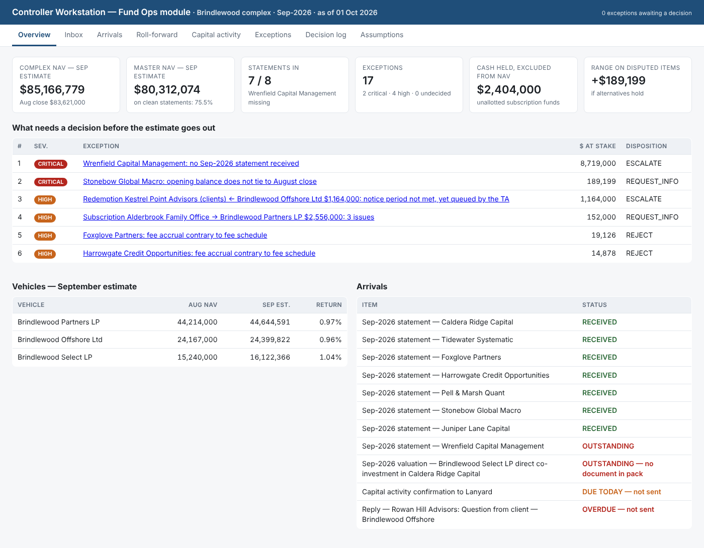

# Controller Workstation — Fund Ops module

**Equi take-home · MD, Agentic Fund Finance & Legal · Dennis Convery**

One month of a fund-operations inbox for the (fabricated) Brindlewood complex — three feeders, one master, eight managers — ingested, tied out, rolled forward and triaged, with every judgment call left to a person and recorded.

| Deliverable | Where |
|---|---|
| Part 1 — roll-forward, capital activity state, ranked exceptions | [`outputs/PART1_RECONSTRUCTION.md`](outputs/PART1_RECONSTRUCTION.md) (+ CSVs in `outputs/`) |
| Part 1 — the one-page decision | [`docs/DECISION.md`](docs/DECISION.md) |
| Part 2 — the working slice | `fundops/` · run it: `python -m fundops serve` |
| Part 2 — the plan and the success metrics | [`docs/PLAN.md`](docs/PLAN.md) |
| Video walkthrough script | [`docs/DEMO_SCRIPT.md`](docs/DEMO_SCRIPT.md) |
| Decisions and trade-offs, how I used AI | below |



## Setup

Python 3.11+. Three dependencies: pandas, openpyxl, Flask.

```bash
pip install -r requirements.txt
python -m fundops run        # ingest → check → roll forward → outputs/ ; state in state/workstation.sqlite
python -m fundops seed       # load the Controller's recorded dispositions (decisions/seed_decisions.json)
python -m fundops serve      # workstation UI at http://127.0.0.1:8765
python -m fundops status     # one-screen summary
python -m fundops reset      # clear the decision log to re-walk the month live
python -m fundops decide "capital:redemption:RED-13" escalate --by "Name (role)" --why "..."
python -m unittest discover -s tests -v     # 22 tests
python tests/verify_outputs.py              # independent re-derivation of every published figure from the raw pack
```

The pack is in `data/assessment-pack/` exactly as received. Nothing in `outputs/` is typed in; delete the folder and `run` regenerates it byte-for-byte.

## What it does

```
inbox/*.txt ──► load ──► classify (named rules) ──► parse statements (csv | xlsx | email body | fixed-width)
attachments/        │                                parse capital (instructions, TA acks, wires)
prior close ────────┴──► reference (sleeves, vehicles, look-through, register, fee schedule as parsed)
                                   │
                                   ▼
                     checks: prior-close ties · statement absence / opening-tie / arithmetic / fees vs schedule
                             capital instruction↔wire↔dealing-date · notice periods vs register · correspondence SLAs
                                   │                      │
                                   ▼                      ▼
                     roll-forward (sleeve → master → vehicle → complex)      ranked exceptions + explicit passes
                                   │                      │
                                   ▼                      ▼
                     outputs/ (CSV + Markdown)     SQLite: documents · arrivals · exceptions · append-only decision log
                                                          │
                                                          ▼
                                            Flask UI: Overview · Inbox · Arrivals · Roll-forward · Capital · Exceptions (dispose) · Decision log · Assumptions
```

**The boundary.** The system reads, ties, matches, derives and ranks. A person decides. Every exception carries its evidence (document names), its arithmetic, and a recommended action; every disposition carries a name, a timestamp and a required rationale, and is appended, never overwritten. Re-ingesting keeps decisions on exceptions that still exist and closes the ones the data resolved.

## September in one paragraph

Seven of eight statements arrived; five tie on every check. **Wrenfield sent nothing** (the absence). **Stonebow's opening is $185,000 under the August close** while its own arithmetic is perfect (only visible across two documents). **Foxglove** charged its management fee on closing NAV at a quarterly rate and says so in its own notes; **Harrowgate** accrued incentive under its high-water mark (both inside one document, against the schedule). **Alderbrook** wired $152,000 less than its signed subscription, four days after the dealing date. **Kestrel Point** gave 22 days' notice on a 30-day vehicle and the TA queued it anyway. A $3.1M direct co-investment has no valuation. An advisor's question has gone 20 business days unanswered. Lanyard's "reconciled" August package disagrees with Wrenfield's own August statement. Complex estimate **$85,166,779** (Aug $83,621,000), master $80,312,074, with $2,404,000 of cash held outside NAV and a disclosed $189,199 range. Decision: publish tomorrow with two disclosures, hold two items, dispute two fees, and answer two people today — [`docs/DECISION.md`](docs/DECISION.md).

## Decisions and trade-offs

- **Deterministic parsing, no LLM in the number path.** Every figure must be reproducible by a reviewer with the pack and a calculator. Four formats this month were all rule-parseable. The plan puts LLM extraction *behind* the parsers for formats no rule claims, with a human confirming the mapping before anything reaches NAV.
- **Return units are inferred, not trusted.** `1.42%`, `0.0207` and `2.04` all appeared this month. The unit that reconciles to the NAV movement wins and the inference is recorded; if neither does, the statement is captured and the arithmetic check flags it. Nothing is silently "fixed".
- **Passes are recorded as deliberately as failures.** 69 explicit ties are what let a CFO trust the 17 exceptions.
- **Policies are declared, with reasons, in one file** (`fundops/config.py`): missing sleeve carried flat; direct co-investment rolled at the manager's sleeve return; disputed opening → manager's (lower) closing with the alternative disclosed; subscription cash held in the vehicle; P&L allocated on prior-close ownership; admin fee accrued; Kestrel redemption deferred as base case with "as queued" alongside. Each is a judgment call and is presented as one.
- **Conservative where the error is the manager's.** Foxglove's and Harrowgate's errors both understate NAV; the estimate uses their reported figures and the overcharges are disputed, not silently corrected.
- **The expected-arrivals list is derived, not typed.** One statement per sleeve, one valuation per direct position, one acknowledgement per instruction, one bank statement per cash balance, plus our own deliverables. A new sleeve creates an expectation automatically.
- **Severity, then decision-required, then dollars.** Ranking is explicit and testable; a $0 unanswered advisor question outranks a $12K prior-period curiosity because it needs an action today.
- **SQLite + Flask, not Streamlit, not a hosted anything.** Three dependencies, runs anywhere, testable headless. Rough edges are visible and listed in `docs/PLAN.md`.
- **Scope I chose not to build:** equalisation / series accounting, mid-month P&L on subscription cash, multi-currency, outbound email, auth. Each is in the plan with an order and a reason.

## Where it would break

- A manager whose CSV header isn't `opening_nav_usd`-shaped, or an XLSX with the data row not directly under the header — falls to the unparseable queue (correct behaviour, but a person is needed).
- Two investors with the same first word in their names would confuse wire matching (`_tokens` in `capital_checks.py` is deliberately simple).
- A fee schedule in a different layout — the parser reads this Markdown; a PDF schedule needs a new reader.
- Notice-period logic assumes month-end / quarter-end dealing; a fund dealing on the 15th needs the fund-terms reference data from the plan.
- Classification is rule-ordered; a manager emailing "statement" in the subject of a marketing letter would be mis-filed (and the arithmetic checks would then fail loudly).

## What I checked before trusting it

1. Every parsed statement printed next to its source and eyeballed (`statements_parsed.csv`).
2. Prior close package tied to itself before anything was rolled from it (sleeves + cash = master; ownership % × master = vehicle interest; look-through = ownership × sleeves; HWM table = fee schedule).
3. 22 unit tests on fees, return-unit inference, period detection, notice dates, and pipeline invariants (vehicles sum to complex, P&L shares sum to master P&L, held cash excluded from NAV, scenario changes only Offshore).
4. `tests/verify_outputs.py` re-derives every published figure from the raw files with plain arithmetic and no `fundops` import — 42 checks, all pass.
5. The UI exercised headless: every tab renders; a disposition posted through the form lands in the log; an empty rationale is refused.
6. One hand-arithmetic error of my own (I initially thought Harrowgate's closing didn't tie) was caught by the code, which is the point of building it.

## How I worked with AI

I used Claude (Anthropic) as a pair: I set the design — the boundary between system and person, the modelling policies, the dispositions and the decision memo's positions — and it wrote most of the code and first drafts of the documents against that design, which I reviewed and edited. The reconstruction's findings were produced by the code, not by either of us reading the pack and asserting numbers; the independent verification script exists so a reviewer doesn't have to take that on trust. Where the model's hand arithmetic disagreed with the code, the code was right.

## Layout

```
data/assessment-pack/   the pack, untouched          fundops/ingest/      inbox, classify, statements, capital, reference
outputs/                Part 1, generated            fundops/checks/      prior_close, statement, capital, correspondence
docs/                   DECISION, PLAN, DEMO_SCRIPT  fundops/rollforward.py · arrivals.py · state.py · report.py · app.py · cli.py
decisions/              seed_decisions.json          tests/               unit tests + independent verification
state/                  SQLite (generated, ignored)
```
